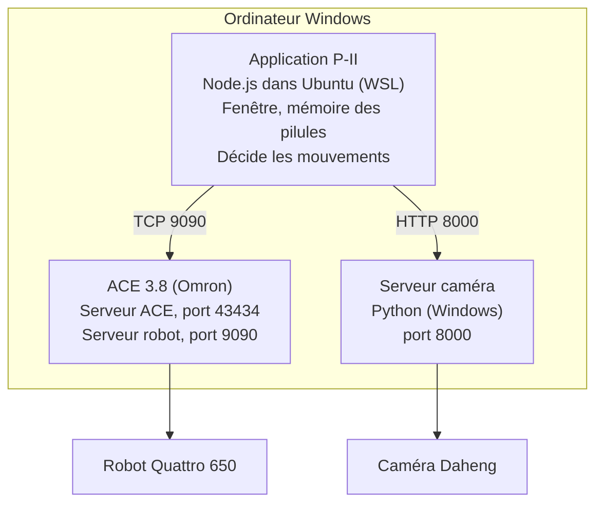
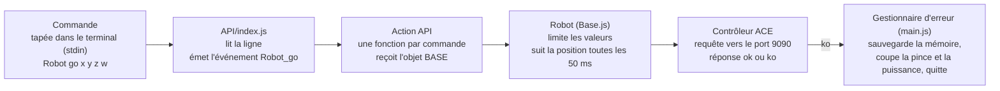

# P-II — Documentation d'exploitation et d'installation

30 octobre 2026 · Vincent Evrard

## Vue d'ensemble

P-II est le logiciel qui fait trier et dessiner des pilules par un robot Omron Quattro 650, guidé par une caméra. L'application tourne dans Ubuntu (WSL) sur un ordinateur Windows et parle à deux services du même ordinateur.

P-II envoie les ordres de mouvement à ACE, qui les transmet au robot, et demande les images au serveur caméra.

| Composant | Rôle | Où il tourne |
| --- | --- | --- |
| Application P-II | Fenêtre, mémoire des pilules, décisions, journal | Ubuntu (WSL), `simulator/P-II` |
| ACE 3.8 | Pilote le robot ; serveur robot sur le port 9090 | Windows |
| Serveur caméra | Prend les photos et détecte les pilules | Windows, `cv/camera_server.py` |
| Scripts de démarrage | Lancent et surveillent tout | `scripts/` |

## Procédure d'allumage

Allumer l'installation tient en deux gestes : mettre le robot et l'ordinateur sous tension, puis attendre. Tout le reste (ACE, déverrouillage du robot, application P-II) se lance seul.

### Étapes

1. Vérifier que la zone du robot est dégagée et que le bouton d'arrêt d'urgence (E-STOP) est déverrouillé.
2. Mettre le contrôleur du robot sous tension.
3. Allumer l'ordinateur Windows. La session s'ouvre toute seule (connexion automatique).
4. Attendre. Une fenêtre « P-II.controller » s'ouvre au premier plan et affiche le journal de l'application.
5. Ne pas toucher à la souris pendant que ACE démarre : un script simule des clics pour déverrouiller le robot.
6. Quand la fenêtre graphique de P-II apparaît (table, grille, pilules) et que le journal défile sans erreur, l'installation travaille.

### Ce qui se passe tout seul

| Ordre | Action | Qui |
| --- | --- | --- |
| 1 | Ouverture de session Windows | Connexion automatique |
| 2 | Lancement de `start_p2.bat` | Tâche planifiée à l'ouverture de session |
| 3 | Fenêtre « P-II.controller » mise au premier plan | `P-II.controller.ontop.ahk` |
| 4 | Démarrage d'Ubuntu (WSL) puis de `start_p2.sh` | `wsl.exe` |
| 5 | `npm run start`, puis `scripts/initAce.mjs` | `start.sh` |
| 6 | Serveur ACE (port 43434), projet `driver.perpetuite3.ace.awp`, serveur du robot (port 9090) | `initAce.mjs` |
| 7 | Clics de déverrouillage du robot | `fakeUser.ahk` |
| 8 | Lancement de l'application P-II | `release/P-II` |

### Si ça ne démarre pas

- **Fenêtre « V+ Memory Download Conflict » dans ACE** : choisir « Controller » (ou « Workspace ») à la main, ce qui débloque le chargement du projet. Un clic manuel est alors nécessaire.
- **Rien ne s'ouvre après la session Windows** : lancer `start_p2.bat` à la main (double-clic) et lire la fenêtre.
- **Message d'erreur dans la fenêtre** : voir la section « Où trouver les messages d'erreur ».
- **Test sans robot** : mettre `SIMULATION=1` dans `.env` ; ACE n'est alors pas lancé.

## Procédure d'extinction

Pour éteindre proprement, il suffit d'appuyer sur l'arrêt d'urgence en face avant : l'application sauvegarde sa mémoire, coupe la pince et la puissance du robot, puis Windows s'éteint seul.

### Extinction normale

1. Appuyer sur l'E-STOP en face avant du robot. ACE renvoie l'erreur 908.
2. L'application sauvegarde la mémoire des pilules, relâche la pince et coupe la puissance (HighPower).
3. Elle se termine avec le code 42, et `start_p2.sh` lance `shutdown.exe /s /f /t 0` : arrêt immédiat, sans mise à jour.
4. Une fois l'ordinateur éteint, couper le contrôleur du robot.

### Que fait l'ordinateur selon le code de sortie ?

| Code de sortie | Cause | Action de l'ordinateur |
| --- | --- | --- |
| 42 | E-STOP (erreur 908), arrêt normal | Arrêt forcé de Windows |
| 0 | Fin volontaire de l'application | Rien |
| Autre (1…) | Erreur 604, 901, 906 ou plantage | Redémarrage forcé de Windows |

Garde-fou : si l'ordinateur a déjà redémarré plus de 3 fois en 10 minutes (journal `/home/perpetuite/reboots.log`), il ne redémarre plus, pour éviter une boucle sans fin.

### Empêcher l'arrêt ou le redémarrage automatique

Pour travailler sur la machine sans qu'elle s'éteigne, mettre `AUTO_POWER=0` dans `.env`. Les deux actions sont alors désactivées. Si la ligne est absente, elles restent actives.

### Arrêt manuel de l'application seule

- Dans un terminal Ubuntu : `npm run stop` (arrête le serveur caméra et les processus P-II).
- Arrêter Ubuntu seul : `wsl --terminate Ubuntu-24.04` depuis Windows.

### Windows sans mise à jour à l'arrêt

Le fichier `scripts/disable.windows.update.txt` donne deux clés de registre qui masquent « Mettre à jour et arrêter ». Les mises à jour restent possibles à la main, de temps en temps.

## Où trouver les messages d'erreur

Le premier réflexe est de lire `/home/perpetuite/p2.log` : c'est la copie texte, sans caractères de mise en forme, de tout ce qu'affiche la fenêtre « P-II.controller ». Les autres journaux servent à creuser.

### Les journaux

| Journal | Emplacement | Contenu |
| --- | --- | --- |
| Console P-II | Fenêtre « P-II.controller » | Tout ce que l'application affiche, en direct |
| `p2.log` | `/home/perpetuite/p2.log` (Ubuntu) | Même contenu, conservé, avec une ligne « === date : démarrage === » à chaque lancement |
| `camera.log` | `log/camera.log` dans le dossier P-II | Serveur Python de la caméra (port 8000) |
| Trace ACE | Fenêtre de trace d'ACE | Chaque commande envoyée (`->`) et réponse (`<-`) du serveur robot |
| `error.list.txt` | `data/error.list.txt` | Liste des erreurs enregistrées par l'application |
| Images d'archive | `data/archive/<année>/<MM.jj>/<heure>/` | Photos prises par la caméra, classées par date |
| `reboots.log` | `/home/perpetuite/reboots.log` | Redémarrages automatiques (garde-fou) |

Pour suivre le journal en direct depuis Windows : `wsl -d Ubuntu-24.04 -u perpetuite tail -f /home/perpetuite/p2.log`.

### Codes d'erreur du robot (ACE)

| Code | Signification | Réaction de l'application | Que faire |
| --- | --- | --- | --- |
| 604 | Erreur robot | Sauvegarde, arrêt, sortie 1 : redémarrage automatique | Attendre le redémarrage ; relire `p2.log` si ça boucle |
| 901 | Collision d'obstacle détectée | Idem | Vérifier la table et les pilules, puis laisser redémarrer |
| 906 | Erreur robot | Idem | Idem |
| 908 | E-STOP face avant | Sauvegarde, arrêt, sortie 42 : extinction de Windows | Rien : c'est l'arrêt normal |
| FORBIDDEN | Zone interdite touchée | Si `AUTO_START` est actif, relance `Exec_start` | Aucune, sauf répétition |
| Autre | Erreur inattendue | Affiche la pile d'appels, sortie 1 | Copier la pile d'appels depuis `p2.log` |

Dans tous les cas, avant de quitter, l'application sauvegarde la mémoire des pilules, ouvre la pince et coupe la puissance du robot.

### Messages fréquents

- **« NOT PILL »** : la caméra a vu une forme qui n'a pas la taille ou la rondeur d'une pilule. Regarder l'image dans `data/archive/`.
- **« DropZone is occupied »** : la zone de dépôt est prise ; l'application cherche une cellule libre et déplace les pilules gênantes (jusqu'à 3 essais).
- **« V+ Memory Download Conflict »** : fenêtre d'ACE au démarrage ; répondre à la main (voir l'allumage).
- **« npm: command not found »** : Node n'est pas chargé dans Ubuntu ; vérifier que `start_p2.sh` charge nvm.

## Structure du logiciel

L'application est un programme Node.js dont chaque ordre passé au robot suit le même chemin : une ligne de commande devient un événement, puis une fonction d'API, puis une requête à ACE. Le code source est dans `src/`, compilé vers `release/` par `npm run build`.

Une réponse « ko » d'ACE déclenche l'erreur : le gestionnaire de `main.js` sauvegarde, met le robot en sécurité et quitte avec le code qui commande l'extinction ou le redémarrage.

### Commandes

Une commande s'écrit `Outil action paramètres`, par exemple `Robot go x y z w`. Elle appelle la fonction `Outil_action`.

### Dossiers

| Dossier | Contenu |
| --- | --- |
| `src/main.js` | Point d'entrée : crée la grille, le robot, la mémoire, la caméra, l'interface ; gère les erreurs |
| `src/API/` | Les commandes, classées par outil (voir ci-dessous) |
| `src/Robot/` | `Base.js` (robot), `Controller` (liaison ACE, protocole ok/ko) |
| `src/Pills/`, `src/Memory/` | Modèle des pilules et mémoire de leurs positions |
| `src/Grid/`, `src/Floor/`, `src/Forbidden/` | Grille de positions, table, zones interdites |
| `src/Camera/` | Capture et conversion pixels vers millimètres |
| `cv/` | Serveur caméra et détection (Python) |
| `scripts/` | Démarrage, arrêt, ACE, AutoHotkey |
| `data/` | Mémoire, images d'archive, listes d'erreurs |
| `release/` | Code compilé que l'on lance réellement |

### Les familles de commandes (`src/API/`)

| Famille | Rôle |
| --- | --- |
| `Exec` | Cycle de travail : `start`, `loop`, `task`, `move`, gestion des erreurs de dépôt |
| `Robot` | Ordres bas niveau : `go`, `grab`, `drop`, vitesse, pince, puissance |
| `Move` | Mouvements prédéfinis (marche, tiroir, chasse) |
| `Memory` | Chargement et sauvegarde des positions de pilules |
| `Camera`, `Image`, `Real` | Capture, traitement d'image, position réelle |
| `Forbidden`, `Probes`, `Command` | Zones interdites, mesures de hauteur, trajets |

### Important après une modification du code

Il faut relancer `npm run build` : l'application lance `release/`, pas `src/`. Un `release/` périmé provoque des comportements qui ne correspondent plus au code.

## Installation sur un nouvel ordinateur

Il faut installer sept briques dans l'ordre : Windows, WSL avec Ubuntu, Node, le projet, ACE, la caméra, puis le démarrage automatique. Compter une demi-journée, ACE et la caméra étant les plus longs.

### 1. Windows

1. Windows 10 ou 11 avec WSL2 et WSLg (pour la fenêtre graphique de P-II).
2. Créer une session et activer la connexion automatique : `netplwiz`, décocher « Les utilisateurs doivent entrer un nom … ».
3. Appliquer les deux clés de registre de `scripts/disable.windows.update.txt` (pas de mise à jour à l'arrêt), puis redémarrer.
4. Installer AutoHotkey v1 dans `C:\Program Files\AutoHotkey\`.

### 2. Ubuntu dans WSL

1. `wsl --install -d Ubuntu-24.04`, avec l'utilisateur `perpetuite`.
2. Installer nvm puis Node : `nvm install --lts`.
3. Copier le projet dans `/home/perpetuite/perpetuite-III/` (dossier `simulator/P-II` pour l'application).
4. Dans `simulator/P-II` : `npm install`, puis `npm run build` (compile `src/` vers `release/`).
5. Rendre les scripts exécutables : `chmod +x scripts/*.sh`.

### 3. ACE (Omron)

1. Installer Omron ACE 3.8 (`C:\Program Files (x86)\Omron\ACE 3.8\bin\Ace.exe`) avec la licence du robot.
2. Vérifier que l'espace de travail `driver.perpetuite3.ace.awp` est dans `/home/perpetuite/perpetuite-III/`.
3. Configurer la liaison avec le contrôleur du robot (Quattro 650) et vérifier que le serveur robot répond sur le port 9090.

### 4. Caméra

1. Installer Python pour Windows et le pilote Daheng (bibliothèque `gxipy`).
2. Le serveur `cv/camera_server.py` écoute sur le port 8000 ; `start.camera.sh` le lance depuis Ubuntu.
3. Renseigner `CAMERA_HOST` avec le nom de l'ordinateur Windows.
4. Contrôler : `/health` répond sur `http://<hôte>:8000/health`.

### 5. Configuration `.env`

Le fichier `.env` de `simulator/P-II` contient tous les réglages. Les groupes principaux :

| Groupe | Clés | Rôle |
| --- | --- | --- |
| Mode | `SIMULATION`, `AUTO_START`, `AUTO_POWER` | Simulation (1) ou réel (0), démarrage auto, arrêt/redémarrage auto |
| Fenêtre | `UI_*`, `PREVIEW_*`, `FLIP_*` | Taille, position, miroirs de l'affichage |
| Robot | `ROBOT_HOST`, `ROBOT_PORT`, `ROBOT_RADIUS`, `ROBOT_MAX_Z`, `ROBOT_*_SPEED/ACC/DCC` | Connexion et limites de mouvement |
| Pilules | `PILL_COUNT`, `PILL_LOCK_DURATION`, `PILL_SAVE_PATH`, `PILL_LOCKED_SAVE_PATH` | Nombre, verrouillage, sauvegardes |
| Zones | `FORBIDDEN_*`, `GRID_*` | Zones interdites et grille de positions |
| Caméra | `CAMERA_HOST`, `CAMERA_PORT`, `CAMERA_PX_PER_MM`, `CAMERA_OFFSET_*`, `CAMERA_EXPOSURE_*` | Connexion et étalonnage |

### 6. Démarrage automatique

1. Copier `scripts/start_p2.bat` en local sur Windows (un `.bat` lancé depuis `\\wsl.localhost` déclenche un avertissement de sécurité).
2. Créer une tâche planifiée « À l'ouverture de session » qui lance ce fichier.
3. Option : placer un raccourci dans `shell:startup`.

### 7. Vérifications

- [ ] `SIMULATION=1` : `npm run start` ouvre la fenêtre sans erreur.
- [ ] `SIMULATION=0` : ACE démarre, les ports 43434 et 9090 écoutent.
- [ ] La caméra répond sur `/health`.
- [ ] Double-clic sur `start_p2.bat` : tout se lance, `p2.log` se remplit.
- [ ] Redémarrage complet : l'installation démarre seule.
- [ ] Test d'extinction avec `/t 60` dans `start_p2.sh`, avant le réglage final à `/t 0`.
